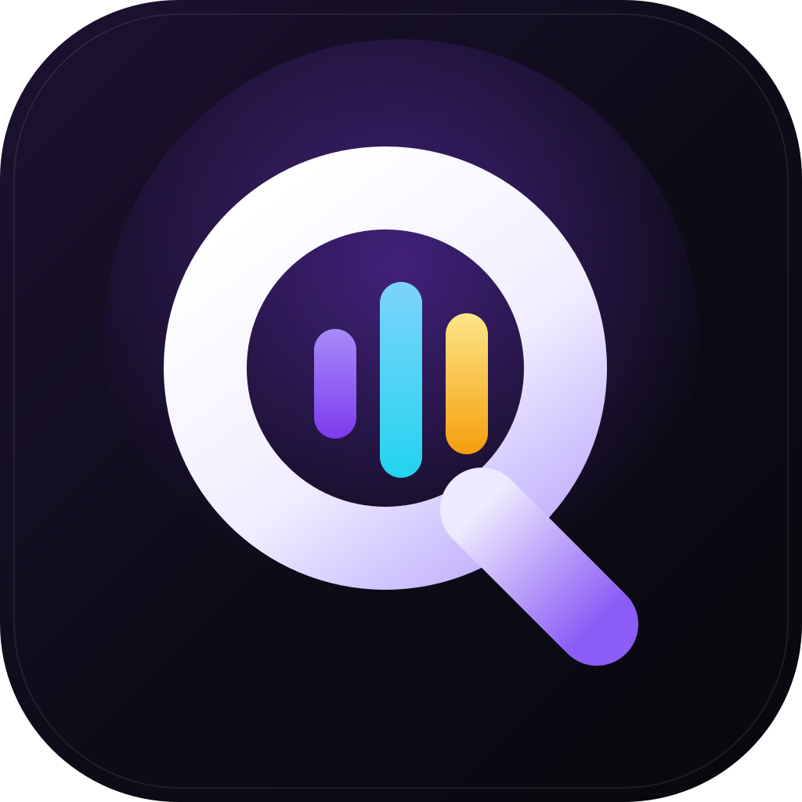
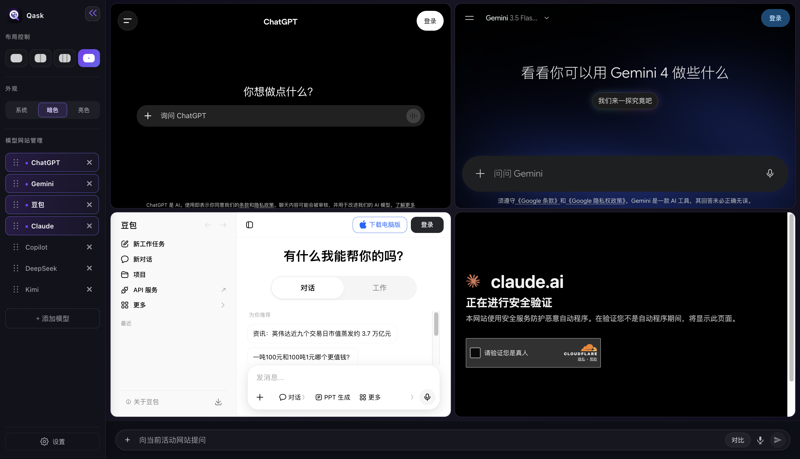
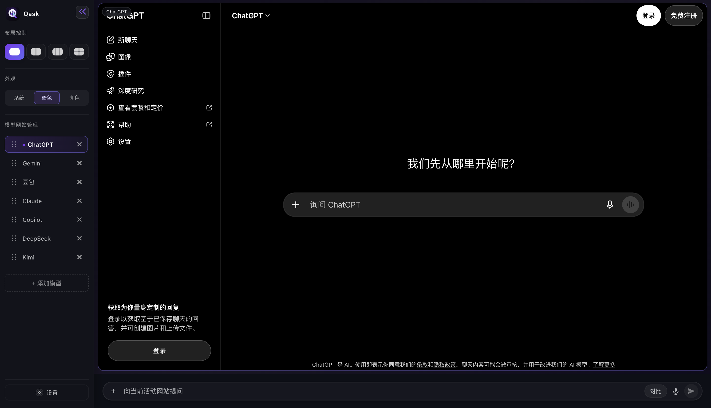
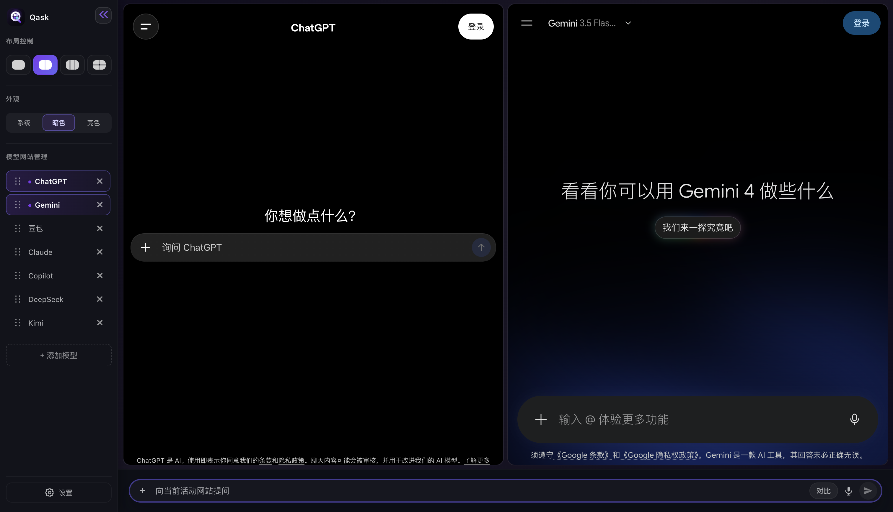
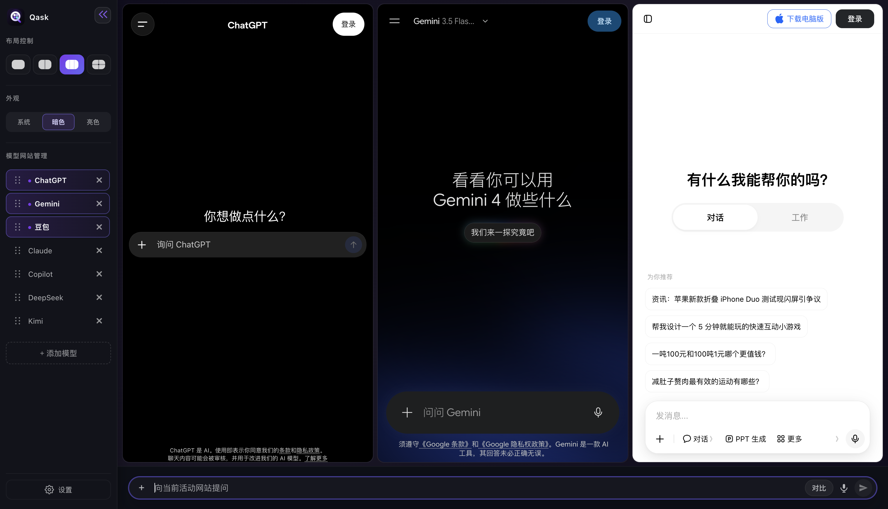
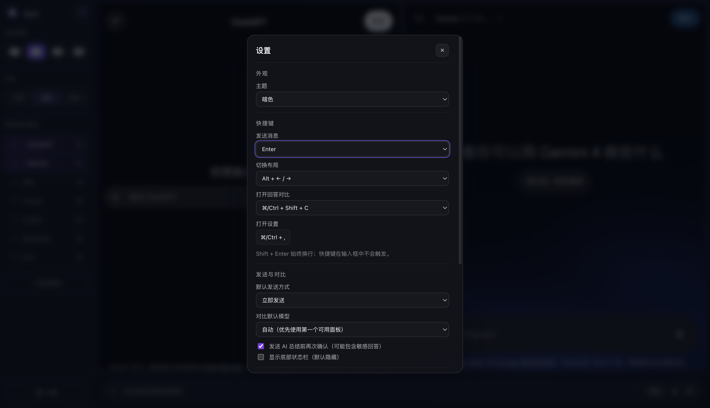
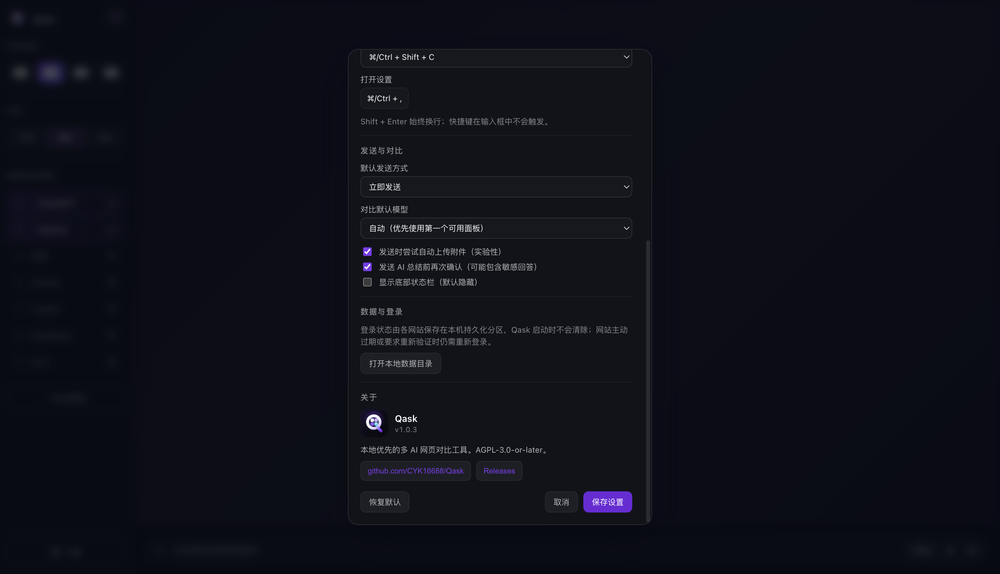
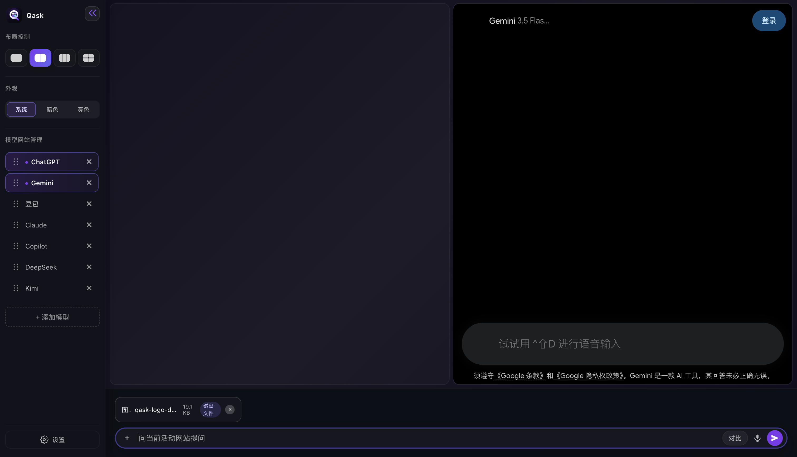

# Qask

<p align="center"></p>

**Qask is a local-first macOS and Windows desktop app for multi-AI comparison: ask one question once and send it to ChatGPT, Gemini, Doubao (豆包), Claude, Copilot, DeepSeek, and Kimi side by side — every answer stays in its own official web UI, and no API key is required.**

[](https://github.com/CYK16688/Qask/actions/workflows/ci.yml)
[](https://github.com/CYK16688/Qask/releases)
[](LICENSE)
[](https://www.electronjs.org/)
[](https://nodejs.org/)

> **Release status:** Qask is open source under **AGPL-3.0-or-later**. The macOS arm64 preview is attached to the [latest release](https://github.com/CYK16688/Qask/releases) for evaluation; production distribution still requires clean-account validation. Version 1.0.3 adds a **Windows x64 preview** (portable + installer) under [v1.0.3](https://github.com/CYK16688/Qask/releases/tag/v1.0.3); the Windows builds are unsigned, cross-built from macOS, and have not yet been validated on Windows hardware.

[English](#overview) · [中文](#中文说明)



## Overview

Qask is a multi-AI comparison workspace for macOS and Windows. It puts the official AI websites of your choice in one desktop window — side by side — and sends the same question to the active panels. Sign in to each website yourself (Qask never asks for an API key), select a one-, two-, three-, or four-panel layout, and compare the models' answers directly in their original web UIs: ChatGPT, Gemini, Doubao (豆包), Claude, Copilot, DeepSeek, and Kimi (Moonshot AI), plus any custom HTTPS website you add.

Qask is **not** a multi-provider API client. It does not use model APIs or a Qask-hosted model. For comparison, it reads the visible answer text from the active panels (best-effort DOM extraction), shows the answers side by side with synchronized scrolling, and can ask one selected panel to summarize the differences. Extracted answers stay in memory and are not saved by Qask.

## Why Qask?

- **Compare in context** — keep each provider's own website, account, model selection, and conversation context visible.
- **One prompt, multiple sites** — use a unified composer to attempt concurrent text delivery to active panels.
- **Live answer comparison** — open “对比” to read the latest answer from each active panel, scroll the panes together, refresh at any time, and let one selected model summarize the differences. Extraction is best-effort and never uses an API key.
- **Visible local status** — a status strip above the composer shows page readiness, per-panel send results, timeouts, attachment handling, and recording state; it only renders Qask-owned text.
- **Flexible workspace** — switch between focused, side-by-side, three-column, and 2×2 layouts.
- **Theme** — follow the macOS appearance or pin the Qask shell to dark/light; provider sites that support `prefers-color-scheme` follow the same preference.
- **Send modes and queue** — hover the send button to choose immediate send, queue, or fill-only. A queued prompt first waits for any in-flight answers to finish, then sends and advances automatically once every panel has finished.
- **Settings** — configure theme, panel auto-zoom, always-on-top, launch-at-login, shortcuts, default send mode, default comparison model, attachment auto-upload, AI-summary confirmation, status transcript visibility, and local-data access; the About section links the version, AGPL license, and the open-source repository.
- **Local by design** — Qask has no Git, GitHub, repository scanning, cloud sync, or provider API integration.
- **Explicit attachment handling** — images, audio, PDFs, and microphone recordings stay local; drag files onto the composer or pick them with `+`, review the tray above the text field, then choose them in each provider's visible upload UI. Recordings and pasted images are saved to `~/Pictures/Qask Attachments/`.

## Screenshots

| One panel | Two panels |
| --- | --- |
|  |  |
| Focus on one AI website. | Compare two websites side by side. |

| Three panels | Four panels |
| --- | --- |
|  |  |
| Keep three sources visible at once. | Use a 2×2 grid for four sources. |

| Settings | About |
| --- | --- |
|  |  |
| Theme, shortcuts, send mode, comparison defaults, and status. | Logo, version, AGPL license, repository link, and local-data access. |

The screenshots were captured in version 1.0.3 from a fresh, unauthenticated Qask profile in dark theme, after each active third-party page reached `document.readyState === "complete"` and settled for several seconds. They contain no account identity, user prompt, response, credential, or conversation history. The visible pages are public landing, sign-in, or verification states—some services may show an anti-bot gate—so they demonstrate loaded webviews and layout, not successful third-party message delivery or model output. Settings screenshots show only local Qask UI with the pages blurred behind the dialog. The About panel links the open-source repository and the version. Third-party UI, names, and marks remain owned by their respective providers; the screenshots are documentation-only and do not imply endorsement.

## Features

### Workspace and websites

- One, two, three, and four panel layouts; cycle layouts with `Alt + ←` / `Alt + →` while focus is in the Qask shell (use the sidebar layout buttons while a website panel has focus).
- Built-in website entries for ChatGPT, Gemini, Doubao (豆包), Claude, Copilot, DeepSeek, and Kimi (Moonshot AI / 月之暗面).
- Drag to reorder websites; every entry (built-in or custom) can be removed, and removed built-ins can be restored from the sidebar. The first *N* sites populate an *N*-panel layout without unnecessarily reloading existing pages.
- Add a custom **HTTPS** website. Custom sites are fill-only by default; automatic send requires explicit consent for that exact origin.
- A separate persistent Electron session partition per website, so website logins are isolated and typically survive an app restart on the same machine.

### Composer, attachments, and screenshots



- A shared bottom composer for the active panels: `Enter` sends, `Shift + Enter` inserts a newline.
- Local attachment queue for images, audio, and PDFs: up to 5 files and 20 MB total. Drag files onto the composer or use `+`; the tray sits above the text field so you can keep typing. Images are limited to 5 MB; audio and PDFs to 10 MB each.
- Explicit local microphone recording (up to 2 minutes); recordings become local audio attachments.
- Attachment turns are never injected or auto-sent by Qask. Choose, preview, and send files through the target website's own visible upload interface.
- Screen-region capture saved locally to `~/Pictures/Qask Screenshots/`.

### Privacy and security boundaries

- No Git, GitHub, filesystem scanning, API-key storage, cloud sync, or provider API requests.
- Qask does not read or upload repositories, `.git`, Git configuration, GitHub CLI data, SSH keys, cookies, environment files, or browser profiles.
- Only text you explicitly submit is offered to active third-party webpages. Qask validates trusted HTTPS origins before text injection.
- Remote websites run in isolated, sandboxed webviews with Node access, popups, downloads, and provider permissions denied.

Read the complete [privacy and local-data boundary](PRIVACY.md) and [security policy](SECURITY.md) before using Qask with sensitive information.

## Quick start

### Requirements

- macOS is the primary tested target; Windows x64 is supported by the cross-build configuration but still needs hardware validation.
- Windows builds require no separate native build environment when produced from macOS (electron-builder downloads the Windows Electron runtime); building on Windows itself is also supported.
- Node.js **22.12.0 or later** and npm.
- A **完整源码仓库 checkout** (full source checkout), including `package-lock.json` and the `test/` directory.

### Download the macOS preview

The signed and notarized Apple Silicon preview is attached to the [latest release](https://github.com/CYK16688/Qask/releases). Verify the downloaded DMG before opening it:

```bash
shasum -a 256 -c Qask-1.0.2-arm64.dmg.sha256
```

The app inside the DMG is signed with a Developer ID Application certificate and notarized by Apple; the DMG carries the stapled notarization ticket. The DMG itself is not code-signed. This is an evaluation preview, not a production-supported build — review macOS permission prompts and validate with a clean account before relying on it.

### Download the Windows preview

Download the [v1.0.3 Windows preview](https://github.com/CYK16688/Qask/releases/tag/v1.0.3):

- [Qask-1.0.3-win-portable-x64.exe](https://github.com/CYK16688/Qask/releases/download/v1.0.3/Qask-1.0.3-win-portable-x64.exe) — portable single executable, no installation;
- [Qask-1.0.3-win-setup-x64.exe](https://github.com/CYK16688/Qask/releases/download/v1.0.3/Qask-1.0.3-win-setup-x64.exe) — per-user NSIS installer with optional install directory;
- [SHA-256 checksums](https://github.com/CYK16688/Qask/releases/download/v1.0.3/Qask-1.0.3-win-x64.sha256).

These builds are **unsigned**, so Windows SmartScreen may warn. They are **cross-built from macOS and have not yet been validated on Windows hardware**; treat them as a preview and test with a clean profile before relying on them. The Windows build currently targets x64; ARM64 Windows can run it through emulation.

Build them with:

```bash
npm run package:win
# dist/Qask-1.0.3-win-portable-x64.exe
# dist/Qask-1.0.3-win-setup-x64.exe
```

The Windows executable uses the same sandbox, webview isolation, local storage, and attachment rules as the macOS build. Microphone/screenshot support depends on the Electron/Windows APIs and should be checked on the target machine.

### Run from source

```bash
git clone https://github.com/CYK16688/Qask.git
cd Qask
npm ci
npm start
```

On first launch, sign in inside each website panel. Then select a layout, arrange the websites in the sidebar, and send a prompt from the bottom composer.

`npm start` launches Electron's development binary. The logical application name is Qask, but macOS may show the host process as **Electron** in Activity Monitor/Dock. Running a packaged bundle (`Qask.app` / `Qask.exe`) shows Qask as the system application name. A local unsigned macOS bundle can be produced with:

```bash
CSC_IDENTITY_AUTO_DISCOVERY=false npx electron-builder --mac dir --arm64 --publish never
open "dist/mac-arm64/Qask.app"
```

If Electron reports `spawn ENOEXEC` or attempts to use `electron.exe`, the dependencies were installed on a different platform. Reinstall them on the target machine:

```bash
rm -rf node_modules
npm ci
```

Do not modify `node_modules/electron/path.txt` or copy Electron binaries between platforms.

This repository is the supported source distribution. npm publishing is intentionally disabled (`private: true`); `npm pack` creates a **最小运行时包** for inspection only. It **不包含 `package-lock.json`、测试套件或 GUI smoke 脚本** (does not include `package-lock.json`, the test suite, or GUI smoke scripts), so it is not a standalone source distribution for development verification.

## How it works

1. **Choose your layout.** Use the sidebar or `Alt + ←` / `Alt + →`.
2. **Order websites.** Drag entries in “Model Website Management”; the first *N* populate the active *N*-panel layout.
3. **Sign in directly.** Every website remains its own web session, governed by its own terms and privacy policy.
4. **Send text.** Enter a question in the shared composer. Qask attempts to fill and, where permitted, trigger each active website's own send control.
5. **Compare on the pages or in “对比”.** Qask does not claim that a provider accepted a prompt or generated a response—use the actual panel content as the source of truth. The comparison view reads the visible answers, keeps the panes in sync while scrolling, and can ask one selected model to summarize the differences.

For attachments, Qask tries to match the file type to each provider's own `<input type=file>` and sets the local file through Electron's debugging protocol before sending text; the site still controls upload preview and acceptance. If no compatible input exists, Qask reports the failure and keeps the manual-upload fallback.

## Development

```bash
npm test
```

Additional local UI smoke coverage is available with:

```bash
npm run test:layout-ui
```

The project uses Electron 44.3.0 and Node's built-in test runner. See [docs/architecture.md](docs/architecture.md) for the startup chain, webview isolation model, state model, IPC boundary, and known limitations.

## Current limitations

- Website adapters depend on third-party DOM structures, login state, bot checks, and service availability; a send attempt is not proof that a website accepted the message.
- Qask does not support provider APIs or streaming. The comparison view extracts visible answer text with best-effort DOM selectors; if a provider redesigns its page the text may be incomplete or unavailable, and the original panel remains the source of truth. Extracted answers are not persisted locally.
- Websites may change without notice and break their text adapters.
- Using automated interaction with a provider website may be restricted by that provider's terms, account policies, or anti-bot controls; review the provider's current terms before use.
- Automatic attachment upload is experimental: it can fail when a provider changes its composer, hides file inputs in a shadow root, rejects a file type, or requires extra confirmation. Qask cannot prove that a model read an uploaded attachment.
- macOS microphone and screen-capture permissions may be required for recording and screenshots.
- A failed or crashed panel can be reloaded from its overlay; reloading rebuilds that page and keeps its login partition.
- The published macOS arm64 preview is signed and notarized. Production distribution still requires permission-copy review and clean-account validation.

## Documentation

- [User guide](docs/user-guide.md)
- [Architecture and development notes](docs/architecture.md)
- [Privacy and local-data boundary](PRIVACY.md)
- [Security policy](SECURITY.md)
- [Contribution guide](CONTRIBUTING.md)
- [Code of conduct](.github/CODE_OF_CONDUCT.md)
- [Commercial licensing](COMMERCIAL-LICENSE.md)
- [Notices](NOTICE)
- [Repository and distribution boundaries](docs/repository-boundaries.md)
- [Release checklist](docs/release-checklist.md)

## Contributing

Contributions are welcome. Please read [CONTRIBUTING.md](CONTRIBUTING.md) and [SECURITY.md](SECURITY.md) first. Do not include credentials, browser profiles, local data, screenshots containing private content, or exploit details in public issues or pull requests.

## Questions, licensing, and conduct

- **Usage questions, commercial-licensing questions, and code-of-conduct reports:** use [GitHub Discussions](https://github.com/CYK16688/Qask/discussions). Public threads are world-readable — never post contracts, customer data, credentials, or incident details there; ask for a private channel instead.
- **Security vulnerabilities:** use the private reporting channel below, never a public issue.
- **Behavior expectations:** see [CODE_OF_CONDUCT.md](.github/CODE_OF_CONDUCT.md).

## Security

Report vulnerabilities through [GitHub private vulnerability reporting](https://github.com/CYK16688/Qask/security/advisories/new). Do not place secrets, cookies, private repository information, personal data, or exploit details in a public issue. See [SECURITY.md](SECURITY.md).

## License

Copyright © 2026 iCreator.

Qask is licensed under the [GNU Affero General Public License v3.0 or later](LICENSE) (**AGPL-3.0-or-later**). Commercial users may use Qask under the AGPL when they meet its terms; iCreator may offer separate commercial licensing for proprietary distribution or proprietary hosted modifications. See [COMMERCIAL-LICENSE.md](COMMERCIAL-LICENSE.md).

Every tagged source release on GitHub provides the corresponding source for that build. The packaged macOS app additionally ships this license text, `NOTICE`, and `PRIVACY.md` inside `Qask.app/Contents/Resources/`.

## Trademark notice

Qask is not affiliated with, sponsored by, or endorsed by OpenAI, Google, Anthropic, Microsoft, 字节跳动, DeepSeek, 月之暗面, or their products. Names and trademarks of third-party websites belong to their respective owners. Users are responsible for complying with the terms of each service they open.

---

## 中文说明

Qask 是一个本地运行的 macOS / Windows / Electron 桌面工具，专注**多 AI 对比与多模型同屏提问**：把你选择的 AI 官方网页并排放在一个窗口中，通过统一输入框尝试同时发送同一问题；既可在原生界面查看回答，也可用“对比”并排阅读并让一个模型总结差异，无需任何 API Key。

### 主要能力

- 支持单、双、三、四面板布局，`Alt + ← / →` 可在 Qask 界面聚焦时快速切换（面板内聚焦时请用侧栏按钮）。
- 外观主题支持“跟随系统 / 暗色 / 亮色”，并同步给支持深色模式的第三方网页。
- 发送按钮支持“立即发送 / 排队发送 / 仅填入”三种方式；排队消息会先等当前回答结束，再在所有面板完成后自动发送下一条。
- 设置中可配置主题、面板自动缩放、窗口置顶、登录时启动、快捷键、默认发送方式、对比默认模型、附件自动上传、AI 总结确认、底部状态栏（默认隐藏）和本地数据目录；「关于」里显示版本、AGPL 许可与开源仓库地址。
- 内置 ChatGPT、Gemini、豆包（Doubao）、Claude、Copilot、DeepSeek、Kimi 网页入口；可拖动排序，当前布局使用前 *N* 个网站。
- 可添加**自定义 HTTPS 网页模型**；默认只填入文字，只有对精确 origin 明确授权后才会尝试自动发送。
- 每个网站拥有独立持久化 Electron 会话分区，登录状态相互隔离，通常可在本机重启后保留。
- 统一输入框可向活动面板并发尝试填入/发送文本；`Enter` 发送，`Shift + Enter` 换行。
- 支持本地图片、音频或 PDF 队列和显式麦克风本地录音；默认尝试把附件设置到各网站的文件上传控件，失败或关闭设置时仍可发送文字，并在各网站可见上传界面中手动上传。
- 支持本地截图，保存至 `~/Pictures/Qask Screenshots/`。
- 输入框右侧“对比”会读取当前各面板可见的最新回答，并排显示、同步滚动；可随时刷新，也可选择一个模型用 AI 总结差异。回答只保存在内存中，Qask 不写入本地文件。

### 安装与启动

```bash
git clone https://github.com/CYK16688/Qask.git
cd Qask
npm ci
npm start
```

当前主要在 macOS 上验证；Windows x64 可通过 `npm run package:win` 交叉打包为便携版 exe 或安装程序，但尚未在 Windows 真机验收。Windows x64 预览版下载见 [v1.0.3](https://github.com/CYK16688/Qask/releases/tag/v1.0.3)（未签名，SmartScreen 可能提示）。需要 Node.js 22.12.0 或更高版本。完整使用说明见 [docs/user-guide.md](docs/user-guide.md)。已签名并公证的 macOS arm64 预览版 DMG 见 [Releases](https://github.com/CYK16688/Qask/releases)。

使用问题、商业授权咨询与行为准则事项请走 [GitHub Discussions](https://github.com/CYK16688/Qask/discussions)；公开讨论区任何人都能看到，请勿在其中粘贴合同、客户数据、凭据或事件细节。安全漏洞请使用仓库的私密漏洞报告通道。

### 隐私边界

Qask 不包含 Git、GitHub、目录扫描、云同步或模型 API 集成；不会扫描、读取或上传 `.git`、本地仓库、GitHub CLI 配置、SSH 密钥、Cookie、环境文件或浏览器 profile。只有你明确提交的文字才会被尝试交给活动的第三方网页。完整说明见 [PRIVACY.md](PRIVACY.md)。Qask 与 OpenAI、Google、Anthropic、Microsoft、字节跳动、DeepSeek、月之暗面及其产品**没有隶属、赞助或授权关系**。

> Qask 不是 API 聚合客户端。对比视图通过尽力而为的 DOM 读取各面板可见回答，并排展示、同步滚动，也可让一个模型总结差异；读取结果只保存在内存中。第三方网页是否接收消息、上传附件或生成回答，应以网页实际显示为准。
